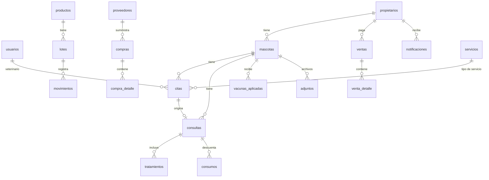

# Modelo de datos (v1)

Convenciones: claves `id INTEGER PRIMARY KEY`; fechas ISO UTC en `TEXT`; dinero en centavos (`INTEGER`); `activo` 0/1; `FOREIGN KEY` siempre activas. Cambios de esquema = nueva migración en `src/db/migrations/`.

## Tablas

### Sistema
- **config**(`clave` PK, `valor`): `nombre_clinica`, `telefono` (505XXXXXXXX), `direccion`, `moneda` (NIO/USD), `iva_porcentaje`, `duracion_cita_min`, `horario` (JSON por día: `{"lunes":{"abre":"08:00","cierra":"17:00"},…,"domingo":null}`). **No se siembra**: los valores por defecto viven en `src/services/settings.js` (JEWA, NIO, IVA 0, 30 min, L–V 8–17, S 8–12, domingo cerrado) y la tabla solo guarda lo que el administrador cambia.
- **usuarios**(id, nombre, usuario UNIQUE, password_hash, rol CHECK IN ('admin','veterinario','recepcion'), colegiado NULL, atiende_citas 0/1, activo, intentos_fallidos, bloqueado_hasta NULL, creado_en).
- **sesiones**(sid PK, datos, expira_en).
- **bitacora**(id, usuario_id NULL, accion, entidad, entidad_id, detalle JSON, ip, fecha). Solo `INSERT`; sin `UPDATE`/`DELETE`.

### Clientes y mascotas
- **propietarios**(id, nombre, cedula UNIQUE NULL, telefono, correo NULL, direccion NULL, acepta_notificaciones DEFAULT 1, activo, creado_en).
- **mascotas**(id, numero_expediente UNIQUE, propietario_id FK NOT NULL, nombre, especie, raza NULL, sexo CHECK IN ('macho','hembra','desconocido'), fecha_nacimiento NULL, color NULL, esterilizado 0/1, foto NULL, estado CHECK IN ('activa','fallecida','inactiva'), creado_en).
- **mascota_propietarios_hist**(id, mascota_id FK, propietario_id FK, desde, hasta NULL).

### Citas
- **servicios**(id, nombre, tipo CHECK IN ('consulta','vacuna','grooming','seguimiento','otro'), precio, duracion_min, activo).
- **citas**(id, mascota_id FK, veterinario_id FK, servicio_id FK NULL, inicio, fin, estado, motivo NULL, notas NULL, creado_por, creado_en).
  - Estados: `programada → confirmada → en_espera → atendida`; salidas: `cancelada`, `no_asistio`.
  - Índice `(veterinario_id, inicio)`. Traslape: existe otra cita del mismo veterinario con `estado NOT IN ('cancelada','no_asistio')` y `inicio < nuevo_fin AND fin > nuevo_inicio`.
  - `veterinario_id` es en realidad el **responsable** de la cita: cualquier usuario activo con `atiende_citas = 1`. Así un groomer puede tener agenda sin crear un rol nuevo (D-21).

### Clínico
- **consultas**(id, mascota_id FK, cita_id FK NULL, veterinario_id FK, fecha, motivo, anamnesis NULL, examen_fisico NULL, diagnostico, observaciones NULL, peso_kg NULL, temperatura_c NULL, frecuencia_cardiaca NULL, frecuencia_respiratoria NULL, estado CHECK IN ('vigente','anulada'), anulada_motivo NULL, anulada_por NULL, anulada_en NULL).
- **tratamientos**(id, consulta_id FK, producto_id FK NULL, medicamento_texto NULL, dosis, frecuencia, duracion_dias NULL, indicaciones NULL).
- **vacunas_aplicadas**(id, mascota_id FK, consulta_id FK NULL, producto_id FK, lote_id FK, fecha, proxima_dosis NOT NULL, veterinario_id FK, estado ('vigente','anulada'), anulada_motivo NULL).
- **consumos**(id, consulta_id FK, producto_id FK, lote_id FK, cantidad, movimiento_id FK). Insumos descontados en una consulta.
- **adjuntos**(id, mascota_id FK, consulta_id FK NULL, nombre_original, archivo, tipo_mime, tamano, subido_por, subido_en).

### Inventario
- **productos**(id, codigo UNIQUE, nombre, categoria, es_medicamento, principio_activo NULL, presentacion NULL, especie_recomendada NULL, unidad, precio, stock_minimo, imagen NULL, activo).
- **lotes**(id, producto_id FK, codigo_lote, vence NULL, cantidad_actual CHECK >= 0, UNIQUE(producto_id, codigo_lote)).
- **movimientos**(id, producto_id FK, lote_id FK, tipo CHECK IN ('entrada','salida','ajuste','reversa'), cantidad (>0), motivo, ref_tipo NULL ('consulta','venta','compra','ajuste'), ref_id NULL, usuario_id FK, fecha).
- **proveedores**(id, nombre, ruc NULL, contacto NULL, telefono NULL, correo NULL, activo).
- **compras**(id, proveedor_id FK, fecha, nota NULL, total, usuario_id FK). **compra_detalle**(id, compra_id FK, producto_id FK, lote_id FK, cantidad, costo_unitario).

### Ventas
- **ventas**(id, numero UNIQUE, propietario_id FK NULL, fecha, subtotal, descuento, total, metodo_pago CHECK IN ('efectivo','tarjeta','transferencia'), estado CHECK IN ('pagada','anulada'), anulada_motivo NULL, anulada_por NULL, usuario_id FK).
- **venta_detalle**(id, venta_id FK, item_tipo CHECK IN ('producto','servicio'), item_id, descripcion, cantidad, precio_unitario, lote_id NULL).

### Notificaciones
- **plantillas**(id, tipo ('cita','vacuna','tratamiento'), texto con variables `{mascota}`, `{fecha}`, `{hora}`, `{clinica}`).
- **notificaciones**(id, tipo, propietario_id FK, mascota_id FK NULL, ref_tipo, ref_id, canal ('whatsapp','correo'), mensaje, estado ('pendiente','enviada_manual','omitida'), generada_para, enviada_en NULL, enviada_por NULL).

## Reglas de integridad
1. No hay `DELETE` sobre: `consultas`, `tratamientos`, `vacunas_aplicadas`, `movimientos`, `ventas`, `bitacora`.
2. `movimientos.cantidad > 0`; el signo lo da `tipo`.
3. `lotes.cantidad_actual` solo cambia junto con un `movimientos` en la misma transacción.
4. Salida FEFO: se consumen primero los lotes con `vence` más cercano que no estén vencidos y tengan existencia.
5. Anular una consulta/venta crea movimientos `reversa` por cada salida asociada.
6. `propietarios.activo = 0` solo si no tiene mascotas con `estado = 'activa'`.
7. El número de expediente y de venta se generan dentro de una transacción (`MAX(id)+1` con formato `EXP-000123`, `V-000123`).

## Datos iniciales (seed)
- Usuario administrador (por script, contraseña ingresada por consola, nunca en el repositorio).
- Servicios base: Consulta general, Vacunación, Seguimiento, Baño, Corte.
- Plantillas de recordatorio por defecto.
- Configuración por defecto (nombre JEWA, moneda C$, IVA 0 %, horario y duración según Q-05): en código, no en la base de datos.
- **Migración `002_datos_iniciales.sql`** (se aplica una sola vez): índice único `servicios(nombre COLLATE NOCASE)`, los 5 servicios base (Consulta general 30 min, Vacunación 15, Seguimiento 20, Baño 45, Corte 60) **con precio 0** y las 3 plantillas de recordatorio (`cita`, `vacuna`, `tratamiento`) con las variables `{propietario} {mascota} {clinica} {fecha} {hora} {vacuna} {medicamento}`.
- **Migración `003_vacunas_base.sql`** (ISS-10): 4 vacunas base como `productos` (categoría `Vacuna`, precio 0) con un lote único `UNICO` cada una (D-41/D-42).
- **Migración `004_venta_anulada_definitiva.sql`** (ISS-14): trigger que impide reactivar una venta anulada (su stock ya se devolvió).
